# Q.E.D.!

A WarioWare-style math game for grade 3 through college. Each microgame is a real math problem that you solve with a few taps and drags, in any order that is mathematically valid. Animals act the operations out, and the expression changes in place while you watch: the exponent drops down for the power rule, a column adds itself up and carries the ten, a term crosses the = sign and changes sign.

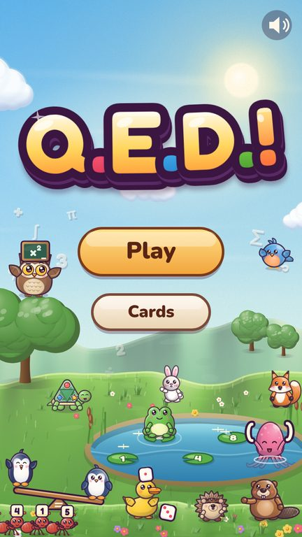
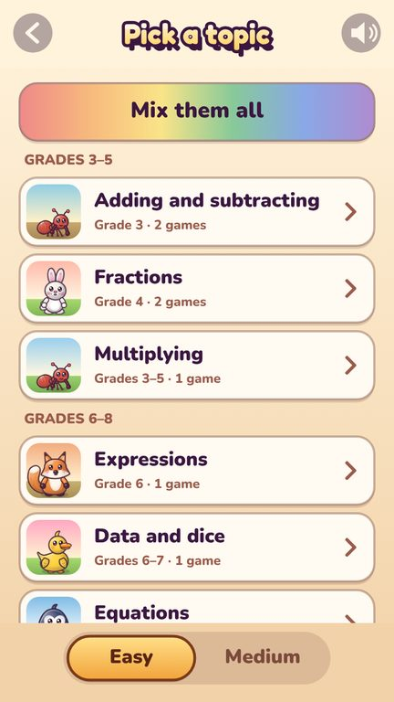
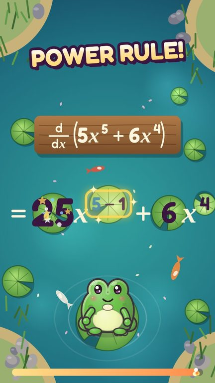
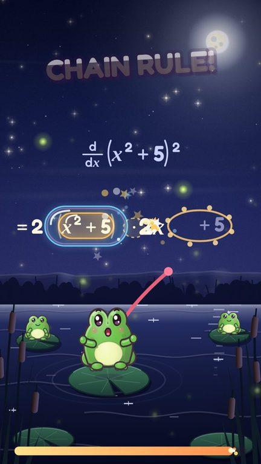

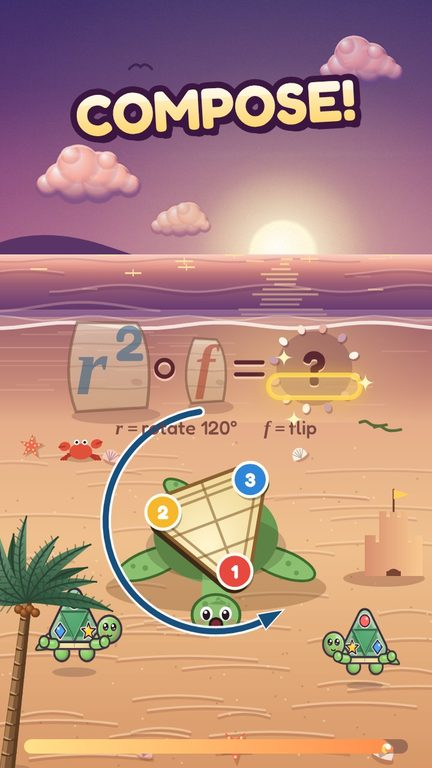
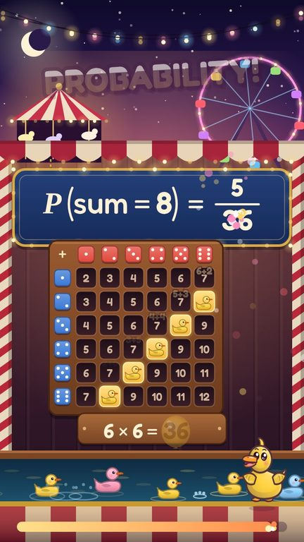
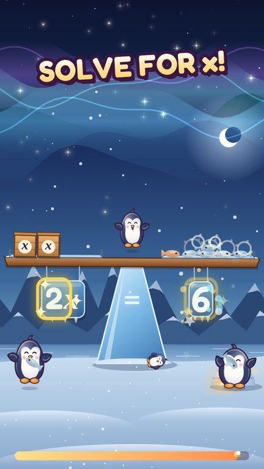
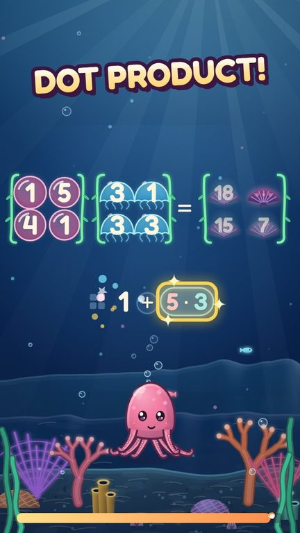

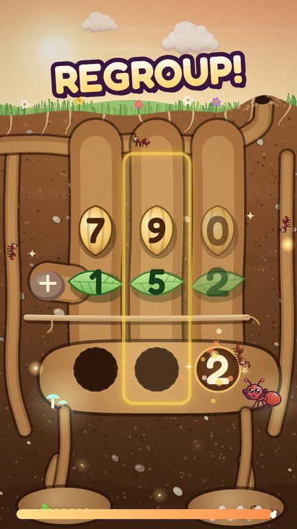
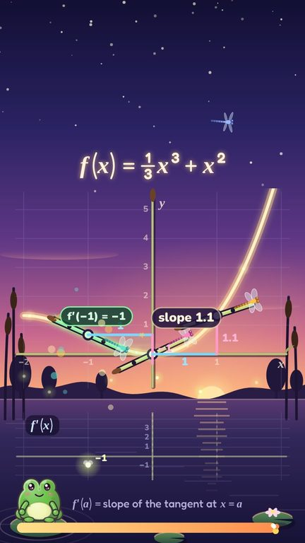
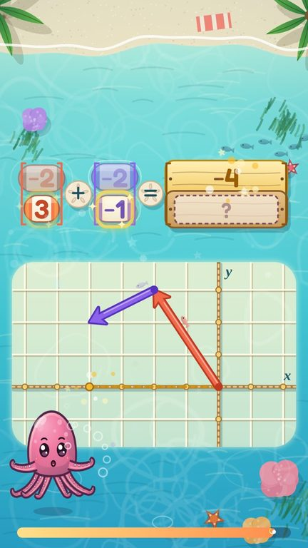

## How it plays
- **Real math, real names.** Commands are the names of the operations ("POWER RULE!", "REGROUP!", "DOT PRODUCT!"), and problems use standard notation, with a small key when a symbol may be new.
- **Taps and drags, never multiple choice (easy mode).** Drag the exponent onto the coefficient, swipe down a column, drag a term across the = sign, then tap a computation to do it. Drops are forgiving. Medium mode also asks you to pick each computed result from a few tiles.
- **Learn while playing.** The next move always glows, a ghost hand shows it at the start, wrong moves only wobble, and the time is generous. Each topic opens with its main idea in one sentence, and every microgame unlocks a card that explains why the rule works.
- **Topics from grade 3 to college:** addition and subtraction, fractions, multiplication, decimals, area and angles, negative numbers, expressions, ratios, equations, exponents, lines, polynomials, quadratics, logarithms, complex numbers, the unit circle, vectors, matrices, probability, limits, derivatives, integrals, series, linear algebra, number theory, logic and sets, and symmetry groups. The full plan, mapped to Khan Academy's courses, is in [docs/CURRICULUM.md](docs/CURRICULUM.md).

## Build and test
- Build: `python3 src/build.py dist/qed.html`, then open the file in a browser. It is one self-contained page with all art drawn in code.
- Test: `python3 tests/run.py` (needs Playwright and Chromium).
- Write a microgame: [docs/MICROGAMES.md](docs/MICROGAMES.md). Microgames still in progress are listed in `src/games/PENDING` and left out of builds.

The engine and the painting library come from the owner's earlier game Holy Moly!. Fonts: Fredoka and Nunito, under the SIL Open Font License (src/OFL-*.txt).
